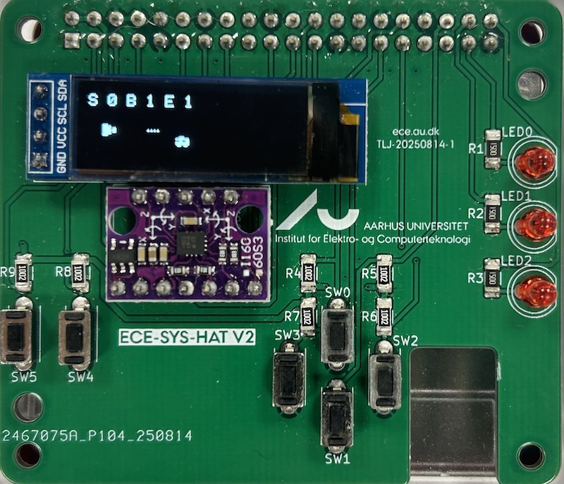
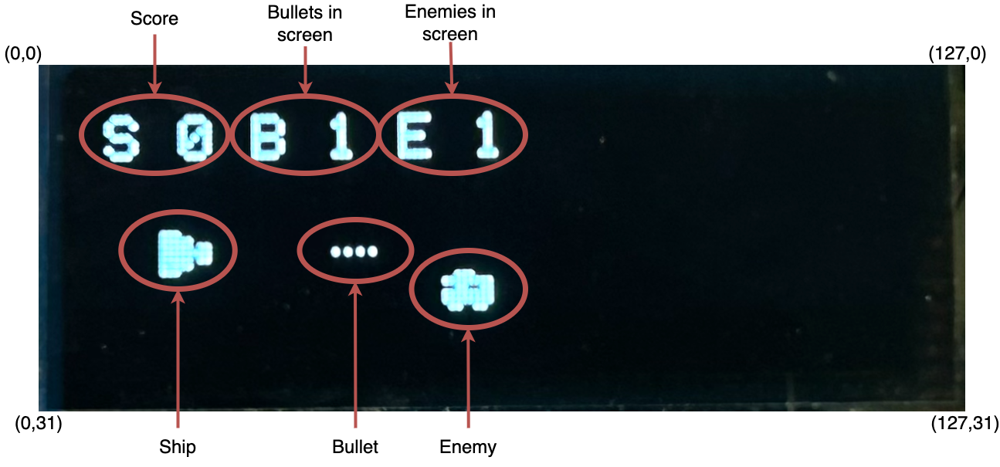
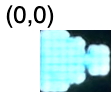
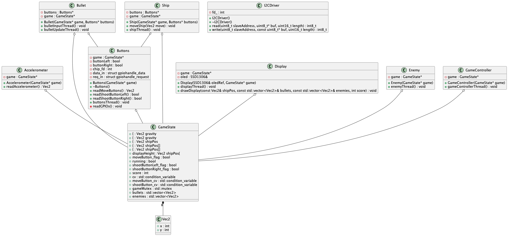
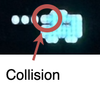

# Space Shooter – Raspberry Pi

A retro space shooter game developed in C++ as part of the Systems (SYS) course at Aarhus University.

## Project Overview

The objective of this assignment was to develop a space shooter game running on a Raspberry Pi, using an OLED display and physical buttons for player interaction.

The project focuses on concurrent programming, thread synchronization, and hardware interaction using POSIX I/O.

## Key Concepts

- **Multithreading:** Using multiple threads to handle game functionality concurrently.
- **Thread Synchronization:** Using mutexes and condition variables to coordinate access to shared game data.
- **GPIO & POSIX I/O:** Reading physical button inputs on the Raspberry Pi.
- **Object-Oriented Programming:** Organizing game logic into separate C++ classes.
- **Hardware Integration:** Interfacing with an OLED display through I2C.

## Assignment Tasks

The assignment involved:

1. Implementing the `Buttons` class to read physical GPIO inputs and detect button presses.
2. Implementing the `Bullet` class to create bullets and

### Focus

* Working with multiple threads
* Thread synchronization with **mutexes** and **condition variables**
* GPIO access using Posix I/O

## Space Shooter

You are tasked with building a simple **space shooter game** on a Raspberry Pi, displayed on a small **OLED screen**. The spaceship is controlled by **four direction buttons**, and the player can fire bullets using a **shooting button**. Some of the code will be provided to kick-start your work, but you will have to implement access to the button gpios, control the space ship and bullets among others.

### Game Requirements

* The spaceship starts at the left center of the screen.
* Direction buttons move it left/right/up/down.
* Tapping the shooting button fires one bullet (per tap)
* Holding the shooting button must fire only one bullet.
* The bullets move to the right at fixed speed.
* Enemies moves in from the right to left at fixed speed (random vertical positions).
* As a bullet and an enemy collide (meet) → bullet and enemy disappears, score increases.
* If an enemy reaches the left side → game over
* There should be no tearing/flickering on the display

Beside these requirements, you are allowed to create additional rules :-)

---

### Hardware Design

The ECE-SYS-HAT provides six buttons (switches), three LEDs, accelerometer, and an OLED dislay.

#### Buttons

You'll see the names of the buttons printed on the printed circuit board (PCB) as seen below. We need this information to assign the buttons to the correct game functions. All buttons are active-low ('0' is actice).



#### Display

The Display is an 128 x 32 pixel OLED display. The pixels are oriented as shown below.



To move the ship *left*, you must *increment* the x-position. To move the ship *up*, you must *decrement* the y-position.

The individual bitmaps (ship, bullet, enemy) use a similar orientation. The provided ship and enemy are 8x7 pixels and the bullet is 8x1 pixels.



This means that placing the ship at (0,0) will place the ship's upper-left corner in the display's upper-left corner. Placing the ship at (0,28) will place the ship's bottom three pixel rows below the screen. You will get run-time warnings if you place bitmaps outside the screen area.

```
   01234567 
28 ###.....
29 #####...
30 ######..
31 ########
   ######..
   #####...
   ###.....  
```

---

### Software Design

Since we are training working with threads, many of the software classes also contains threads to perform work for the individual class. The classes as shown in the Class Diagram below. 



The game is assembled and started in *space_shooter.cpp*

#### `Accelerometer`

This class is a stub, but can be used in later extensions of the game.

The idea is: 
  * Reads the accelerometer at fixed intervals.
  * Updates a global "gravity vector" that affects object motion.

#### `Bullet`

Controls adding bullets and moving them on the screen.

**YOU MUST IMPLEMENT THE CONTENT OF THIS CLASS**

Contains two threads:

  1. Update the bullet vector when with one new bullet if the shoot button has been tapped (pressed-released)
  2. Update the bullet position at a fixed speed

#### `Buttons`

Takes button (gpio) inputs and publishes them for the game.

**YOU MUST IMPLEMENT THE CONTENT OF THIS CLASS**

1) The *Constructor* must be updated so, the gpio inputs are requested and prepared for **level-triggered** reading

2) Create at thread that runs at fixed interval to:
  * Read the GPIO-connected direction + shooting buttons all **level-triggered**.
  * Publish when shooting button has been tapped (pressed-released)
  * Update the shared *game state*.

3)  Implement `ReadMoveButtons()` that returns the latest reading of the move buttons as the following values:
  * up: {0, -1}
  * down {0, 1}
  * left: {-1 ,0}
  * right: {1, 0}
  * None pressed: {0, 0}   

#### `Display`

Runs a thread at fixed interval to:
* Draw the game state (spaceship, bullets, enemies)
* Draw score, number of enemies and bullets

#### `Enemy`

Runs a thread at fixed interval to:
* Spawn new enemies
* Move enemy position
* Delete enemies if they move out of screen (left)

#### `GameController`

Runs the main game control loop thread to:
* Provide collision detection of bullets and enemies. 
* Delete bullet and enemy from `GameState` if they collide.

A collision is detected just as the face of a bullet and the face of an enemy intersect.



Note! The game controller thread deletes bullets and enemies if they collide. Both are stored in vectors. Erasing an element in a vector will invalidate current iteraters using those vectors.

#### `GameState`

Contains the current state of the game. It is accessed by almost all classes and contains vectors of bullets, enemies, x-y positions, score and more. 

#### `I2CDriver`

Implements I2C communication to the OLED screen to be used by the OLED library.

#### `Ship`

Runs a thread at fixed interval to:
* Update ship position according to Move Button state

#### `Main` (space_shooter)

The main loop does the following:
* Initialize I2C and OLED library
* Instantiate objects
* Start threads
* Join threads
